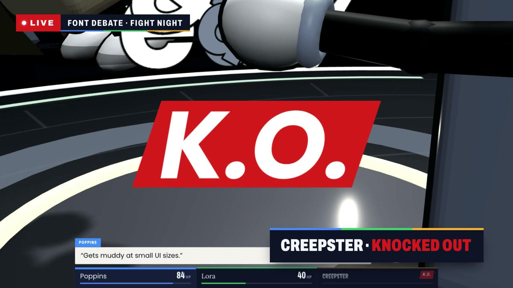

<div align="center">

# Font Debate

**Can't pick a font? Make them fight for it.**

### [▶ Play it here](https://font-debate.vercel.app)



</div>

Tell it what you're building and how it should feel. Three fonts that fit step into a 3D arena and fight it out, one round for each thing you asked for, trash-talking the whole way. The last one standing is your font, and you get a matching second font plus the CSS to use them.

Don't like a contender? Swap in any of the 1,800+ Google Fonts.

I was bored one weekend and vibe-coded it.

## Run it locally

```bash
npm install
npm run dev
```

## Good to know

- Each font has scores for personality ("playful", "serious") and jobs ("easy to read", "good for headlines"). In each round the best-scoring font hits the others, and the one with the most health left wins. The rules are in `src/logic.ts`.
- The voices come from [Kokoro](https://github.com/hexgrad/kokoro), which runs on your computer. The first visit downloads it (about 330 MB). Phones use the normal browser voice.
- Made the same weekend as [Fine Print Court](https://github.com/ShreyashAgare26/fine-print-court), where Terms of Service go on trial.

## License

[MIT](LICENSE). Third-party licenses are in [THIRD_PARTY_NOTICES.md](THIRD_PARTY_NOTICES.md).
